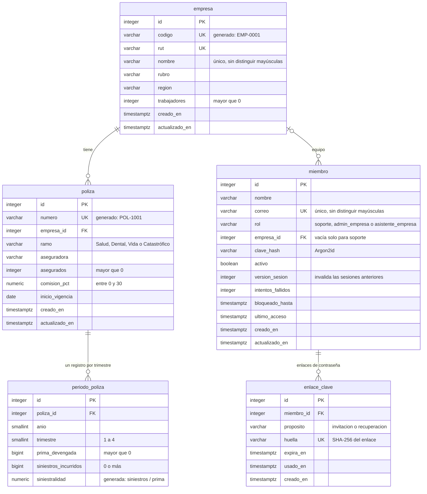

# Evidencias de sistema: base de datos

Equipo 3: Guillermo Mora, José Montesino y Pablo Pinto.
Versión 1.0 de Buk Learning. Fecha de las evidencias: 05-11-2026. Commit de la aplicación: `d043847`.

La base es PostgreSQL 17. El esquema se crea con dos migraciones de Alembic, `esquema_inicial` (14-10-2026) y
`rol_soporte` (21-10-2026), y `alembic check` confirma que los modelos de la API y la base coinciden.

## Modelo de datos



## Reglas que impone la propia base

- **La siniestralidad la calcula la base**, en una columna generada: siniestros incurridos ÷ prima devengada, con
  cuatro decimales. No se puede escribir a mano, así que la interfaz, la exportación y las consultas usan el
  mismo valor.
- **Un registro por póliza y trimestre**, con el trimestre entre 1 y 4, la prima mayor que cero y los siniestros no
  negativos.
- **Códigos generados:** `EMP-0001` para las empresas y `POL-1001` para las pólizas.
- **Sin duplicados:** el RUT y el nombre de cada empresa son únicos, y el correo de cada miembro también.
- **Cada rol con su empresa:** una cuenta de soporte no tiene empresa y una de empresa siempre la tiene.
- **Borrado en cascada:** al eliminar una empresa se eliminan sus pólizas, sus trimestres y su equipo.
- **Datos sensibles:** de la contraseña solo se guarda su hash Argon2id, y de cada enlace, su huella SHA-256.

## Archivos

| Archivo | Qué contiene |
|---|---|
| `esquema.sql` | El esquema completo exportado de la base con `pg_dump`: tablas, columnas generadas, restricciones e índices |
| `consultas_base.txt` | Consultas con `psql`, sin editar: tablas y filas, empresas, pólizas, la siniestralidad de cada trimestre y de la cartera, las 20 restricciones, ocho intentos de guardar datos inválidos que la base rechaza y un cálculo al guardar, dentro de una transacción que se deshace |

En los intentos rechazados, la prima en cero falla por la división de la columna generada, que se evalúa antes que
la restricción `ck_periodo_poliza_prima_positiva`. En ambos casos el registro no se guarda.

## Los datos

Es la base de desarrollo: la semilla (2 empresas con una póliza cada una, sus 8 trimestres y 4 miembros) más una
póliza dental de prueba, POL-1010, que se agregó desde la aplicación. Los montos son redondos para comprobar cada
cálculo a mano:

- POL-1001 en el 3T 2026: 2.800.000 ÷ 4.000.000 = 0,7000.
- Cartera en el 3T 2026: 3.510.000 ÷ 5.050.000 = 0,6950.
- Al guardar un trimestre con prima de 4.000.000 y siniestros por 3.400.000, la base devuelve 0,8500.

Para reproducirla, desde el repositorio de la aplicación:

```bash
docker compose up -d db
cd backend
alembic upgrade head
python -m app.semilla
```
